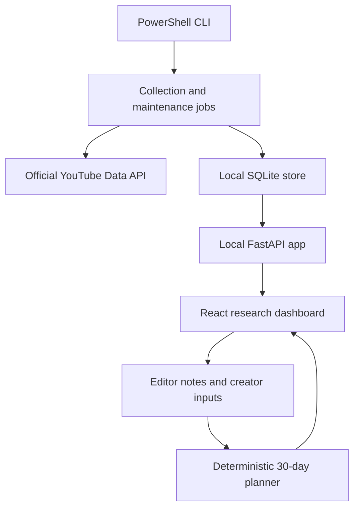

# Engineer Tests GTA — local Creator Intelligence MVP

**Copy-ready master prompt pack for Claude Code or Codex on Windows 11.**  
**13 sequential core phases, 00–12. Phase 13 is optional AI. Phase 14 is final Vercel deployment readiness.**  
This pack builds the application. It does not contain a harvested dataset or pretend research has already been run.

## Start here

1. Create a new, empty Git project folder, for example `C:\Projects\engineer-tests-gta`. Put **this Markdown file** in the root. Use a personal Google Cloud project, not a company project.
2. Open PowerShell in that folder. For Claude Code, install from Anthropic's official distribution. In PowerShell, run `winget install --id Anthropic.ClaudeCode --exact`, reopen the terminal, then run `claude --version` and `claude`. Install Git for Windows if missing. If your free Claude account does not give you Claude Code access, use a supported Claude Code plan or billed Anthropic Console access, or use Codex or another coding agent you already have access to. The pack does not require Claude Code specifically.
3. Paste the **Master bootstrap** block below. It runs **Phase 00 only** and turns this pack into a compact `CLAUDE.md`, an `AGENTS.md` entry point, specs, and individual phase files.
4. After each phase passes, open a fresh coding-agent session and paste the **Phase runner** block with the next number. If a phase is unfinished, resume the same phase. In Claude Code, you can also use `/clear` after files are saved. Do not paste this whole pack into every session.
5. For Vercel readiness, run **Phase 14** after Phase 12 or after optional Phase 13. Record 13 as skipped if you did not want AI. Phase 14 does not deploy or upload your local dataset.
6. Before the Phase 03 live smoke test, enable **YouTube Data API v3** for your Google Cloud project and create a key restricted to that API. Place it only in the private local config documented by the scaffold. Run the fixture mode without any key first. An OAuth login is not needed for public video discovery. The key is for the app, not for the coding agent.

### Which keys do I need?

| Key or account | When | What it does |
|---|---|---|
| Coding-agent access | Phase 00 | Lets Claude Code, Codex or another agent write the application. Separate from app runtime. |
| YouTube Data API key | Phase 03 for live smoke, Phase 04 for collection | Retrieves public YouTube discovery and resource data. The only external runtime credential required for live core research. |
| YouTube owner OAuth | Not required for the core MVP | Possible later connection for your own channel's authorized Analytics data. Start with manual notes from YouTube Studio. |
| Gemini API key **or** Anthropic API key | Optional Phase 13 only | Critiques your original briefs, tightens hooks, or proposes alternative cuts. Add one provider, not both. The calendar, ranking baseline, and dashboard work without it. |

**Default recommendation:** Build with no paid model API. Use a deterministic planner through Phase 12. If you later want AI-assisted editing, try one available Gemini free-tier model on non-sensitive, original drafts only, after checking current terms, or use Claude API if you already have billing. A Claude Code login is not an app API key. Neither provider is used to label 2,500 videos, fabricate video metrics, or predict viral view counts.

## Master bootstrap — paste this first

```text
Act as a senior data engineer, senior product analyst, pragmatic full-stack engineer,
application security engineer, and editorial product designer. Build Engineer Tests GTA,
a Windows 11 local-first creator intelligence tool for my own GTA VI channel.

Read Engineer_Tests_GTA_Master_Prompt.md once. Treat its product, architecture, data
contracts and safeguards as the canonical brief. Execute Phase 00 only now. The data
product must have one primary loop: find YouTube evidence, decide what to film, and build
an actionable 30-day plan across YouTube long-form, YouTube Shorts and Instagram Reels.
Single-player story mode and offline gameplay only. Historical evidence is predominantly
GTA V, with smaller GTA IV and San Andreas comparator samples.

Initialize repo instructions and phase files in Phase 00. Do not attempt to write or run
the whole MVP in this session. Do not invent metadata, real video IDs, statistics, tests,
source citations, dependency scan results, or completion. Do not ask me to paste secrets
into chat. If a missing credential only affects a live test, complete independent fixture
work and record the exact live test that is blocked. Preserve any existing files.
```

## Phase runner — paste this in each fresh session

```text
Execute Phase NN only from docs/phases/NN.md. Start with CLAUDE.md (or AGENTS.md),
STATUS.md, the current phase file, and only the spec sections the phase references.
Check git status and the previous acceptance gate. Report any failing prerequisite with
evidence, fix only what falls inside this phase, and otherwise stop at the blocker.
Implement the phase, run its acceptance tests, and update STATUS.md and PROMPT_HISTORY.md
with exact results and the next command. Do not start the next phase.
```

## Canonical product contract

**Output:** A local dashboard and searchable evidence catalog; an editor's research workflow; a 30-day capture and publishing calendar; and a weekly review loop for the creator's own releases. The output that matters is a brief like “Test whether NPCs react differently to the same road blockage in two districts,” with a fair capture protocol, opening shot, thumbnail composition, platform cuts, and fallback if the mechanic is absent.

- **Study population:** Public, discoverable YouTube videos about GTA V offline gameplay, from its original launch window through collection day. Target **2,500 unique eligible GTA V videos**, with **2,000** as a minimum usable live-sample gate. Aim separately for **100–200 eligible videos each** for GTA IV and San Andreas. Comparator rows do not count toward the GTA V floor. Exclude GTA Online, FiveM/RP, leaks, trailers without gameplay, ambiguous mixed-mode entries until reviewed, and duplicate IDs. Offline mods, full playthroughs, and archival footage are separately marked or excluded from the main cohort and never silently mixed with unmodded discovery videos. Separate original games from remasters, DLC and platform re-releases where known. Older-game samples are YouTube-era surviving uploads, not complete launch-era histories.
- **Research lens:** Give topic-level attention to systems and physics, maps and hidden details, side missions and practical guides, mythology/cheats, and comparisons. The candidate-video library shows current source metadata, live-snapshot dates, thumbnails and direct links. The manual research workflow records what an editor actually saw at a timestamp. Distinguish title hook, visual thumbnail promise and observable cold open. Never claim a hook caused performance because a video got views.
- **Three publishing lanes:** YouTube long-form = full investigation, comparison or useful guide. YouTube Shorts = one fast visual test or payoff. Instagram Reels = a platform-adapted edit of suitable original capture, with its own spoken/on-screen context and payoff. Instagram is an output format in this MVP, **not** a data source, performance estimate or proxy for YouTube.
- **Editorial pillars, separate from formats:** (1) **Systems & Myth Tests**, (2) **Map, World & Hidden Details**, (3) **Missions & Useful Discoveries**. GTA IV/V/San Andreas comparison is a lens across these pillars, not a fourth output format.
- **Day 1 through 30:** Configurable start date, time zone (default Asia/Kolkata), language (e.g. English/Hinglish) and weekly production budget (starter 10–12 hours, editable). Starting target is **4 long-form ideas, 12 Shorts, and 8 Reels** across four editorial weeks, plus Days 29–30 for review/buffer. Every day gets a filming, editing, publishing, or reviewing action. Targets yield to constraints and never imply 30 unique shoots. Plan includes a smaller early-launch queue and next-month adjustments as you publish.
- **Business outcome:** A recurring workflow for making a differentiated YouTube channel, tracking what you actually publish, and choosing what to repeat, change or retire. No monetization guarantee, estimated competitor revenue, automatic posting, billing or audience automation. The core MVP is local. The final phase prepares Vercel deployment without deploying.

## Architecture and repo contract



- **Stack:** Git, a supported stable Python and `uv`, FastAPI, `httpx`, SQLite via stdlib with versioned SQL migrations, and pytest/Ruff. UI uses active supported Node LTS, npm, React, TypeScript, Vite, CSS design tokens, and one verified lightweight chart library only if justified. Use Playwright for the critical browser flows if compatible. Prefer the smallest maintained dependency footprint. Use plain SQL for this data size. No Docker, separate warehouse, ORM, Redis, distributed queue, auth provider, scraping libraries or heavyweight ML stack by default.
- **Runtime:** Single local app; development uses a Vite proxy for same-origin API requests. The packaged local MVP serves the built UI from FastAPI. Bind servers to `127.0.0.1`, not the LAN. Keep YouTube secrets in process env or a gitignored private local config read by the backend/CLI only. Never use `VITE_*` for secrets. Use a single documented data-directory override. Ingest via explicit CLI, not browser request handlers. WAL, foreign keys, bounded busy timeout, bounded batch transactions and predictable crash recovery. No paid infrastructure for the local phases. Keep persistence behind repository interfaces so the final Vercel phase can add a hosted adapter without replacing SQLite locally.
- **Code boundaries:** `backend/gta_lab/` for config, data access, YouTube adapter, collection, policy, research, planning, and API; `frontend/` for UI; `migrations/`; `tests/`; `scripts/` for PowerShell wrappers; `docs/`; `local-data/` ignored by Git. Keep external resource data, sample selection records, editor notes, own-channel notes, and synthetic data logically separate. Use separate fixture and live database paths. Never mirror raw YouTube records into logs, test fixtures, persistent exports, public APIs, cloud model prompts, or Git.
- **Core entities:** `videos`, `channels`, `playlist_sources`, `discovery_runs`, `discovery_hits`, `eligibility_reviews`, `public_statistics_current`, `editor_notes`, `briefs`, `calendar_slots`, `publishing_log`, `owner_metric_entries`, `policy_capabilities`. Keep audit-eligible statistical history in a separately gated table, not enabled by default. Every YouTube record needs source resource/endpoint, `fetched_at_utc`, refresh/delete deadline, and a documented lineage or ownership class. Read/UI logic must suppress expired data even when refresh fails. Nullable values remain null, never zero by convenience.
- **Internal app routes:** `/research`, `/evidence`, `/comparisons`, `/planner`, `/review`, `/data-health`; shared navigation and error/empty states. Private localhost routes like `/api/status`, `/api/evidence`, `/api/evidence/{id}`, `/api/research`, `/api/plan`, `/api/review` exist only to render the local app or manage first-party notes. No open proxy, API-key exposure, or raw source dump.
- **Source hierarchy:** (a) YouTube API numbers/metadata, (b) editor's firsthand observation while watching on YouTube/in an official player, (c) own gameplay notes and original drafts, (d) synthetic fixtures. UI makes the difference obvious. Human packaging notes are different from platform metrics. Current thumbnail URLs and titles are not evidence of the original launch thumbnail or title. Only write an observation as “watched” when a human watched it.

### Durable Markdown files — kept small on purpose

| File | What belongs there |
|---|---|
| `CLAUDE.md` / `AGENTS.md` | Compact common workflow, non-negotiable boundaries, read order, phase stop rule. Have a single canonical copy and a lightweight pointer in the other. |
| `APP.md` | Problem, audience, output, functional scope, exclusions, MVP acceptance. |
| `STATUS.md` | Last completed phase, current phase/task, checks passed/failed/blocked, and exactly one next action. Keep under roughly 80 lines. |
| `PROMPT_HISTORY.md` | Append-only phase ID, date, changed files, test evidence, blocker or deferral. Do not read all entries each time. |
| `docs/SYSTEM_DESIGN.md` | Boundaries, responsibilities, topology, run commands, data lifecycle. |
| `docs/DATA_CONTRACT.md` | Field definitions, null behavior, source lineage, migrations and data separation. |
| `docs/SAMPLING.md` | Query manifest, strata, exclusions, coverage, collection and validation method. |
| `docs/YOUTUBE_POLICY.md` | Official sources, verified allowances, explicitly disabled features, approval scope, retention and AI data use. |
| `docs/ANALYTICS.md` | Public raw reporting, optional computations and guardrails, and evaluation plan. |
| `docs/DESIGN.md` | Tokens, page layouts, accessibility, responsive and visual acceptance rules. |
| `docs/CONTENT_PLAYBOOK.md` | Pillars, three publishing lanes, capture protocols, thresholds and review process. |
| `docs/SECURITY.md` | Threat model, dependency/credential controls, reports and residual risks. |
| `docs/DECISIONS.md` / `README.md` | Short decision log; Windows instructions and demo path. |
| `docs/DEPLOYMENT.md` | Local vs hosted topology, Vercel settings, environment matrix, data lifecycle, launch and rollback procedure, first written in Phase 14. |
| `docs/phases/00.md` to `14.md` | Only that phase's prompt with inputs, work and acceptance. |

### Always-on implementation rules

- Before changing code, state scope and the acceptance commands. At the end, record **passed**, **failed**, **not run**, or **blocked** for each gate. If a phase grows, split it into checkpoints inside that phase and resume it from `STATUS.md`. Never load the 2,500 rows into an agent context. Query bounded samples, schema and summarized health counts.
- Verify current package versions against official maintainers/registries and advisories **at installation time**. “Latest” means latest compatible, supported, stable release that passes checks, not an unreviewed newest version or a caret-only dependency list. Commit `uv.lock` and `package-lock.json`. Use locked installs (`uv sync --locked`, `npm ci`). Record runtimes. Prefer official indexes and review publisher, repository, release provenance, licenses, transitive changes and install scripts. Do not blindly change package names or use downloaded scripts from unknown sources.
- Audit both graphs, including dev dependencies, using npm audit and a verified Python lockfile-aware advisory tool such as OSV-Scanner, or `pip-audit` on the resolved locked environment. Add secret scanning and SBOM generation for the release. A stopped/failed scan is not a clean scan. Block release on known exploitable high/critical findings unless remediation is completed; record lower-severity findings and mitigation. Report time, tool, actual result and limitations. **No scanner can certify zero vulnerabilities or malware.** Avoid unnecessary postinstall scripts; document any required scripts and review them before allowing. Do not apply `npm audit fix --force` or auto-run arbitrary upstream code.
- All imported strings are data, never instructions. Use parameterized SQL, safe escaping, strict payload schemas and lengths, bounded pagination, preconfigured Google API destinations, HTTPS, API key redaction, and no arbitrary URL fetch. Restrict browser origins and host headers, and reject cross-origin state-changing requests. No secrets, logs, tokens or database snapshots leave the machine by default. Dev live calls are explicit and budgeted. Fixtures have no real IDs or metrics.
- Prefer simple software and observable results. Unsupported data should display `Unavailable`, `Unknown`, or `Not yet collected`. Do not make placeholders look complete, use fake “live” status, hardcode performance findings or leave dead controls in the UI.

## Phase 00 — Spec, safeguards and context setup

**Read:** This master pack only for initialization. **Write:** Markdown contracts, phase files and minimal Git hygiene; no app implementation.

```text
Create the durable Markdown files and individual docs/phases/00.md through 14.md.
Copy only the relevant phase block and read/write pointer into each phase file. Transfer
canonical requirements into their specific docs so future sessions do not need the
master pack. Put current data-source URLs in YOUTUBE_POLICY.md. Record the build gate,
live data gate, approval-only, optional AI, and Vercel readiness gates separately. Define independent
work versus capability blocks. In STATUS.md, distinguish implementation done from
live verification. Create .gitignore with actual proposed local data, secrets and caches.
Do not initialize outside the current repo or replace existing user work. Check Git,
PowerShell, Python, uv, Node and npm availability without installing unrelated tools.
Document missing prerequisites and the recommended supported installer for each.
Acceptance: all 15 phase files are present, the two agent entry points work without
duplication, canonical decisions are named, and the next-session command is unambiguous.
Stop here.
```

## Phase 01 — Windows scaffold and reproducible run loop

**Read:** `APP.md`, `docs/SYSTEM_DESIGN.md`, `docs/SECURITY.md`.

```text
Implement the smallest working backend and frontend, /api/status, local smoke page,
typed env settings, .env.example with placeholders, and PowerShell bootstrap/run/check
commands. Produce exact runtime minimums and lockfiles after verifying versions. Make
Windows paths with spaces work. Support an explicit demo mode and data-dir override.
Document safe install, locked rebuild, dev proxy and packaged same-origin run. Script
commands must exit nonzero on failures. No YouTube requests, real data, or cloud APIs.
Acceptance: locked installs repeat, backend and frontend smoke tests run, app starts
without any key, and secrets cannot appear in the frontend bundle or status response.
```

## Phase 02 — SQLite, migrations and data lifecycle

**Read:** `docs/DATA_CONTRACT.md`, `docs/YOUTUBE_POLICY.md`, `docs/SYSTEM_DESIGN.md`.

```text
Implement versioned SQL migrations and repositories for source, run, note, plan and
review entities. Store public stats as current values with UTC fetch timestamps and
expiration. Avoid persistent raw response bodies. Default to the standard YouTube
retention mode: refresh or delete applicable public API data no later than 30 calendar
days; proactively refresh before expiry. Default to replacing current competitor stats
on refresh, not building a permanent snapshot archive. Handle deleted/private/missing
items, API-error vs missing distinctions, new thumbnails/titles and expired source
references in derived views and exports. Do not read or expose stale metadata just
because a refresh failed. Purge expired API-derived cache, associations and artifacts
as required. Retain only independently authored notes/brief text with no copied API
data when source references are no longer eligible. Avoid uncontrolled DB backups.
Acceptance: fresh and repeat migration, duplicates, null semantics, transaction rollback,
fake-clock refresh/purge tests, inaccessible video handling, and fixture/live isolation.
```

## Phase 03 — YouTube client and small live smoke test

**Read:** `docs/YOUTUBE_POLICY.md`, `docs/DATA_CONTRACT.md`, `docs/SECURITY.md`.

```text
Build a read-only official YouTube Data API adapter for search.list, videos.list,
channels.list, and playlistItems.list. Support seed links/IDs but normalize and validate
them before calling configured endpoints. For channel discovery use configured source
channels' uploads playlists wherever efficient. Hydrate video IDs in supported batches
(up to 50 per videos.list request); use partial response fields. Request current title,
channel ID/name, publishedAt, description only where needed and permitted, duration,
category, thumbnails, counts (views/likes/comments when provided), available language
and embeddable/status hints. Do not assume a reliable public Shorts flag or infer it
from duration alone. Do not request comments text, caption download or video files.
Classify missing metrics as unavailable. Implement per-bucket quota estimation, pagination,
timeout, jittered bounded retries on eligible transient errors, and clean no-retry or
resume states for bad key, permission errors and quota exhaustion. Verify current
defaults and Console quotas; do not hardcode old 100-unit search pricing.
Acceptance: mocked malformed/retry/quota/batch/secret-redaction tests; with an authorized
key run a small live check of 5–15 videos and record the exact counts, methods and units
without logging keys or bulk payloads. If no key, label the live portion blocked.
```

## Phase 04 — Sampling and resumable live collection

**Read:** `docs/SAMPLING.md`, `docs/DATA_CONTRACT.md`, `docs/YOUTUBE_POLICY.md`.

```text
Build a versioned query and seed-channel manifest. For GTA V sample launch-window,
early years, mature back catalog and recent uploads, with dates bounded at collection.
Use separate age/era buckets for comparator games, include or report launch-year gaps,
and record known editions/remasters separately. Verify original release dates in
official sources and store the citations. Start with long-tail keyword families for
systems/physics, maps/secrets, side missions, guides, myths and comparisons. Combine
date-bounded relevance/date searches, some popularity searches, and configured uploads
or curated YouTube playlists. Never rely on just most-viewed or one channel. Keep a
configurable per-channel concentration threshold with an override and explicit report.
Treat language and region settings as discovery hints, not audience demographics.

Implement two CLI modes: plan (no network with estimated budget) and run/resume
(explicit network, bounded date windows/pages/candidates and search quota caps). Track
discovery path, page/cursor, query, era, locale, run time, retries, duplicate IDs,
unavailable results, and eligible/excluded/review counts. Persist checkpoints
idempotently. Exhaustion pauses rather than losing the run; use the next quota window
or authorized extension, never multiple projects/keys to bypass limits. Use the current
quota docs: standard allocation lists a 100-calls/day search bucket and 10,000 daily
units for other methods. Verify actual project limits before each live run. Fifty full
hydration batches are enough for 2,500 already-known IDs in isolation, not an estimate
for the complete collection or the number of eligible videos.

Run staged live collection: tiny smoke, roughly 200–400 candidates for sampling QA,
then expand in batches sized for duplicate and exclusion rates. Phase 05 owns final
eligibility, so leave collection resumable and return here for backfill from Phase 05
if needed. Pilot quality, not raw search count, determines whether coverage is good.
Acceptance: two-run resume tests, auditable funnel, era/topic coverage and concentration
report, estimated-versus-actual request counts, fixture run and live pilot if possible.
No promise to enumerate every original YouTube upload, recover removed content, or
reconstruct launch-week view counts from a current cumulative counter.
```

## Phase 05 — Game/mode eligibility and annotation workflow

**Read:** `docs/SAMPLING.md`, `docs/YOUTUBE_POLICY.md`, `docs/ANALYTICS.md`.

```text
Build screening states accepted, excluded and needs_review with reasons. Record
base game/edition, offline confirmation or uncertainty, language when evidenced,
format evidence, discovery family and reviewer status in a way allowed by policy.
Treat metadata search matches as candidates, not facts; under default policy use curated
source queries/seed choices plus a human inclusion queue, not automatically inferred
API-derived content types or tags. Optional add-on taxonomy enrichment from API data
is disabled until approved for the actual use case. Mixed offline/Online goes to review,
not the denominator. Distinguish manually verified vertical Shorts, standard uploads,
build-specific footage and unknown; duration alone cannot establish format.

Design a blind-to-views audit queue straddling eras, topics, formats and mid-sized
channels. Full human review is acceptable for the small pilot; at full scale, combine
well-vetted offline seed cohorts with stratified manual adjudication, spot checks and
a conservative unknown bucket. Label the difference between human-verified and
source-qualified records. Do not silently certify the entire set as watched. Start
a 100–150-row packaging audit independently, stratified across eras and control
examples, rather than implying 2,500 watched videos. Aim to intentionally review
some low/ordinary performers when available. Let scope and progress be visible.

Add a simple click-to-watch workflow using YouTube's official page or IFrame, respecting
non-embeddable videos. Editor fields: visual focal point, crop/contrast, text amount,
title promise phrased in the editor's own words, first shot, cold-open device,
timestamp of first payoff, format certainty, and reviewer confidence. Keep title and
thumbnail observations separate from actual opening observations. Never invent or
download a transcript, thumbnail archive or media. Keep raw URLs and source metadata
in the refreshable API store, with no permanent copying into annotations. Independent
manual notes are clearly identified and separate from API metrics; verify allowed
linking/display in the policy doc. If not supported under the standard mode, use the
editor workspace with YouTube links as navigation and no combined metrics.

Acceptance: resolve conflict fixtures, enforce all exclusions, audit real sampled rows
if access exists, document counts by qualification level, and report live truthfully:
target 2,500 qualified and hydrated GTA V rows, minimum 2,000, comparator samples separate.
Backfill where necessary without faking counts. If the live gate is blocked, continue
independent app work in labeled fixture mode and leave the exact live task outstanding.
```

## Phase 06 — UI system and working application shell

**Read:** `docs/DESIGN.md`, `APP.md`, `docs/SYSTEM_DESIGN.md`.

```text
Design an editorial analyst's workstation with original coastal-night styling: shell
#10151D, primary surface #18202B, near-white text #F0F1F3, seafoam #70D6BF for actions,
and muted coral #FF8C79 for sparse emphasis. Test contrast and adjust if needed.
Use available system fonts and tabular numerals. Original, faint shoreline/contour art
can appear in the shell only, not as an invented GTA VI map. Do not use Rockstar logos,
copied artwork, in-game screenshots as shell decoration, neon gradients, glass cards,
oversized marketing copy, animated chrome, or emoji-heavy dashboards. Legitimate
YouTube thumbnails can appear only in the evidence experience as sourced content.
Include an unofficial/no-affiliation note and show source attribution.

Desktop layout: slim left navigation, central work area, resizable or collapsible
evidence detail rail if useful. Research starts with sample coverage and one clear
next action. Evidence uses a dense sortable table and detail drawer. Comparisons
show side-by-side examples with unknowns. Planner opens to this week's queue and
supports a 30-day grid and chronological list. Review surfaces a record-and-decide
workflow. Mobile: list-first, compact filters, full-screen detail and practical tap
targets. Provide text/table alternatives for charts, visible focus, keyboard routing,
empty/error/refreshing/quota-limited states and reduced-motion support. The Research
workflow, not a cinematic cover, is the default landing page.
Acceptance: keyboard and contrast check, screenshots at about 1440 and 390 px,
no overflow, no dead controls, and four distinct real-state examples rendered.
```

## Phase 07 — Evidence Explorer and cross-game research

**Read:** `docs/DATA_CONTRACT.md`, `docs/ANALYTICS.md`, `docs/DESIGN.md`, `docs/YOUTUBE_POLICY.md`.

```text
Build bounded typed endpoints and connect real UI. Evidence Explorer supports video
search, game/edition, date era, channel, available language, curated discovery source,
verification status and format filters where supported; sort by raw views, date or
title. Render source badge, current title, thumbnail URL, view counts and fetch dates.
Use lazy thumbnails, null fallback, pagination and YouTube source links. Store thumbnail
references, not files. Keep YouTube player behavior and attribution intact.
Detail view shows provenance, metadata, raw counters, and explicit “unavailable
for other creators” watch time, impressions, CTR and retention states. Provide review
notes as a separate explicitly labeled source. Do not label current thumbnails as
the best or original upload artwork. Do not infer views from missing records.

Ship comparisons as curated evidence boards: GTA V vs IV or San Andreas, same question,
similar observable format/era where defensible, multiple examples including ordinary
ones, and what changes in mechanics or audience/platform context. Example questions
are water/physics contrasts, wanted-response differences, map-detail tests and side
mission routes, never statements of actual measured results. “GTA VI adaptation” is a
capture suggestion with an unknown or verified-in-own-gameplay status, not a claim
about unreleased or untested mechanics. No download, scrape, transcript fallback or
new data source. Pick a set of scoped exact-match and multi-filter user flows.
Acceptance: at least one linked comparison workflow, correct filter/sort tests,
provenance visible for every real fact, small-width and missing-data checks.
```

## Phase 08 — Analytics, opportunity ranking, and conditional forecasting

**Read:** `docs/ANALYTICS.md`, `docs/YOUTUBE_POLICY.md`, `docs/SAMPLING.md`.

```text
First verify the current default YouTube policies, guide and additional derived
metrics policy. Build Standard mode using source fields, raw sorting, sample
coverage/QA counts distinct from YouTube business metrics, simple aggregations only
where expressly supported, and editor-only idea ranking. Do not make API-derived
scores, inferred labels, or predictive performance outputs live unless explicit
acceptance covers the specific feature. Write an approval-scope checklist with status,
proof source/date, allowed inputs/output/retention and a hard default-off capability
gate for advanced analytics. A local config flag by itself is not evidence of permission.
Build/test prototypes or evaluation using clearly synthetic data, not unapproved live
data. Do not train or fine-tune on YouTube API data or send it to an external model.

Standard mode planner rank uses independently entered editorial inputs only:
visual proofability 25%, originality 25%, timely/useful payoff 20%, feasible capture
15%, repurpose value 15%, editable and shown line by line. This is an editorial priority
score, not demand or probability. Store source links for the editor to open only as
permitted, no default automated link from raw view counts to rankings. Separate high/
medium/low editorial confidence based on real capture or evidence quality, not a
predicted percentage. Use inputs about actual own recordings, not fake release data.

If and only if YouTube accepts the exact use case, activate separately reviewed
cohort analytics on its approved scope: compare same-format, edition, era, age and
other supportable strata; include sample n, channel concentration, medians and
distributions if permitted, and mark descriptive associations and small cells. Use
predeclared support such as n >= 20 and at least 5 channels, suppress sparse cells,
check leave-one-channel-out, and check selection and survivorship effects. Separate
view definition/reporting eras and watch for format/metric changes. Current subs
are not historical audience size. Lifetime views divided by video age are not
launch velocity; never fabricate age-aligned historical measurements. Store no
extra history without approved retention scope; if approved, statistical and
nonstatistical fields must still use their distinct expiry rules.

For predictive work start with editorial hypotheses and a no-skill baseline.
Only consider an actual performance model on permitted, comparable time-aligned
observations of outcomes such as own-channel day-7 performance, with sufficient
data and appropriate authorization; keep scopes separate. Validate on later held-out
time windows and disjoint channels if the design includes approved multichannel
data, with feature cutoffs before the outcome and out-of-sample errors. Use only
features observable at the decision point; disclose GTA VI and new-channel domain
shift. Do not ship numeric forecasts when data is inadequate or the baseline wins.
Never forecast private watch time/CTR, hallucinate view counts, rank creator revenues,
promise virality, or imply causal thumbnail lift from public counts.
Acceptance: hand-scored fixtures match weights, unknowns surface, no default API-derived
ranking, gated live capabilities fail closed, synthetic backtest checks are reproducible,
and research adds uncertainty and alternatives rather than made-up predictions.
```

## Phase 09 — Day-one queue and 30-day planner

**Read:** `docs/CONTENT_PLAYBOOK.md`, `docs/ANALYTICS.md`, `docs/DESIGN.md`.

```text
Implement an engine and UI for YT long-form, YT Shorts, and IG Reels as independent
output lanes attached to original capture sessions and the three editorial pillars.
Inputs: launch or start date, editing hours, solo creator time, target posting window,
languages, content preferences, available platform/build, spoilers policy, and mechanic
verification. Do not hardcode a launch date or assume access. Support seeded hypothesis
templates, own ideas, edit, pin, rebuild unlocked slots, swap, skip/replace, and copy
an original brief. Show overruns and explain omitted items. Prioritize a lean Days 1–3
queue. Plan roughly four editorial weeks plus Days 29–30 review, with budget-aware
choices, capture/edit/publish tasks, genuine rest or buffer where helpful, and
reusable capture IDs. Never default to daily long-form. Use the 4/12/8 starter mix
when capacity permits and state the planned and actual counts per platform.

Each brief requires: working title and alternate, pillar, format, viewer question,
original angle, first frame, a speakable cold open, shot checklist, test/control or
guide verification, two genuinely different thumbnail hypotheses for long-form,
cover/first-frame design for vertical, payoff beat, rough duration, spoiler level,
time/cost, feasible fallback if unverified, example reference when available, and
an own-channel success measure/review time. For Reels specify how the edit changes
on-screen framing/pacing/context, not “repost this Short.” A test must be filmable
with footage the creator can capture. Do not fabricate multiplayer activities,
GTA VI mechanics, locations or results. Reject generic prompts like “Top 10 Secrets”
unless evidence and a visual test make the specific promise worthwhile.

Acceptance: at least one valid item spaced through each week for all three formats
when the default budget supports it; Day 1 through Day 30 all present; capacity
respected; pinned slots survive rebuild; no duplicate angle; early queue complete;
and original brief/calendar text export only, without bulk YouTube metadata or metrics.
```

## Phase 10 — Own-channel tracking and next-month reviews

**Read:** `docs/CONTENT_PLAYBOOK.md`, `docs/DATA_CONTRACT.md`, `docs/ANALYTICS.md`.

```text
Create an own-channel publishing ledger. Capture original title/thumbnail variants,
actual publish timestamp, format, capture/editor time, hypothesis, who changed which
creative element and when, and outcome review notes. Manual own YouTube Studio metric
entry is optional and separate from the public corpus. Offer 24 h and day-7 checkpoints
without fabricating data if unavailable; preserve metric definition, time window,
source and attribution and use metric sets appropriate to each format. Examples for
long form: owned impressions, CTR and average view duration/retention when available.
For Shorts, prefer available engaged views and relevant creator Studio metrics rather
than comparing raw counts with long form. Never require OAuth for the MVP or mix
owner-authorized results with third-party stats. Keep Instagram performance out of
scope because YouTube is the data source. Reel production and publishing status can
still be tracked as your own operations notes.

Give an honest weekly workflow: mark promising/retest/retire with a short rationale;
distinguish a variant test from co-varying changes; use matched checkpoints for human
review and leave unsupported numeric inference off. Let the editor carry 2–3
observations forward and generate a revised next-week or next-month plan without
overwriting locked work. OAuth is a later addition only with endpoint/metric support,
least privilege, secure token storage, revocation and deletion, separately verified.
Acceptance: log a publish, leave missing metrics blank, review that work, regenerate
an adjusted month, and prove absence of other creators' private data or mixed reporting.
```

## Phase 11 — Reliability, dependency review, and security verification

**Read:** `docs/SECURITY.md`, `docs/YOUTUBE_POLICY.md`, `docs/SYSTEM_DESIGN.md`.

```text
Write automated tests for freshness/purge, duplicate ingestion, quotas and resumes,
live/demo isolation, eligibility, missing values, support thresholds or feature gates,
planner budget/locking, and UI flows from research > evidence > brief > review.
Verify Windows locked installs and same-origin packaging. Test malicious-looking
YouTube text as plain text, host/origin constraints, no credential leakage, rate limits
and paths, timeouts, no unauthorized external fetches, and SQLite integrity. Require
validated server-side inputs and secure defaults including localhost, minimal headers,
and CSP compatible only with documented asset/player hosts. Handle broken thumbnail
and player cases. Use bounded queries and indexes with a synthetic size test of at
least 5,000 rows; show measured timings for common filters on the test machine.

Review exact dependency names, maintainers, transitive changes, required install
scripts and lockfile integrity. Run ecosystem vulnerability scans, secret scan,
and SBOM for runtime/build graphs. Remediate exploitable high/critical issues before
signoff. Document versions, advisories, residual risk, failed checks and whether
any upstream malware/provenance check is unavailable. No blanket “safe” claim.
Acceptance: repeatable quality/security checks, browser smoke, one-time local data
expiry simulation, no secret or real raw dataset in Git, and evidence for all claims.
```

## Phase 12 — End-to-end acceptance, portfolio demo, and release

**Read:** `APP.md`, `STATUS.md`, `README.md`, `docs/ANALYTICS.md`.

```text
Validate from a clean Windows setup or explicitly state that Windows testing remains
unverified if tested in another OS. Deliver one-command local startup, setup/refresh/
purge instructions, lightweight dashboard workflow guide, and a README demo using
only clearly labeled synthetic data when publishing the repo. Write a short portfolio
case study using screenshots that contain synthetic or permitted content: constraints,
source pipeline, sample coverage, analysis limits, planning decisions and what was
actually verified. Include one local walkthrough from evidence to a month plan to
a weekly action. Never publish the raw database or imply proof of YouTube growth.
No credential, billing, deployment or public upload action without explicit user action.

Declare separate gates: (1) APP READY when fixture-driven functions and tests pass;
(2) LIVE SAMPLE READY only after at least 2,000 distinct qualified/hydrated GTA V rows
are present and externally verified through the documented YouTube pipeline, with an
aim of 2,500 and separately stated comparator and manual observation coverage;
(3) ADVANCED ANALYTICS READY only if any claimed feature has scope-specific approval and
passes the separate evidence gate; and (4) AI OPTIONAL, with no dependency in core.
Live mode must retain uncertainty around eligibility and not call fixture IDs real.
If a launch date is shown, it must be manually configured or corroborated by a current
official source, timestamped and labeled. Record actual verification, not intentions.
```

## Phase 13 — Optional AI-assisted editorial critique

**Read:** `docs/CONTENT_PLAYBOOK.md`, `docs/SECURITY.md`, `docs/YOUTUBE_POLICY.md`.

```text
Only implement if requested after the core product. Use one provider (Gemini or Claude)
selected in server-only config, with provider disabled by default. Check official
current model availability, pricing, data handling and SDK advisories. Start with
AI_MODE=off and a curated original-brief payload. Admit only creator-authored,
explicitly selected, non-sensitive fields such as own test idea, rough hook,
shot list and constraints. Do not send YouTube API data, competitor titles or
thumbnails, captions, screenshots, IDs, private YouTube Studio metrics, tokens,
raw DB rows, or full app context. Start with no image upload. Never train/fine-tune.

Offer: critique the premise, shorten the natural spoken hook, suggest two ways
to frame proof and a clearer first shot, or adapt tone/pacing for a Reel. Use
strict structured output, response size/time bounds, cost/request caps and graceful
fallback. Show content diff for editor acceptance and don't silently change rank,
plan, evidence or statistics. Discard output that asserts unverified mechanics or
turns hypothetical metrics into claims. Log only provider, model, timing,
usage/error category and run ID if needed, not prompt text or keys.
Acceptance: full app still passes with no model key; tests prove prohibited fields
cannot be sent, timeouts degrade gracefully, and drafts remain editable by the creator.
```

## Phase 14 — Vercel deployment readiness, no deployment yet

**Read:** `docs/SYSTEM_DESIGN.md`, `docs/SECURITY.md`, `docs/YOUTUBE_POLICY.md`, `README.md`. **Write:** `docs/DEPLOYMENT.md`, deployment config/build files, hosted persistence adapter and smoke tests. Phase 13 is not a prerequisite.

```text
Keep local SQLite mode working and keep the Vite/React UI and FastAPI domain logic.
Verify current official Vercel FastAPI, Python, Node, static asset and routing support.
Prefer one same-origin Vercel project if the build verifies cleanly: expose a supported
FastAPI app entry, stage the Vite build's assets for static CDN delivery, and correctly
route UI deep links without rewriting real /api/* errors to HTML. If current framework
limits prevent this in the existing layout, use a Vercel frontend/backend monorepo
configuration with a fixed same-origin rewrite only if supported and tested. Do not
rewrite the app to Next.js merely to deploy. Document root directory, presets,
build/install commands, runtimes, asset locations and the exact checked-in config.

Ship two hosted profiles with safe defaults.
1. Hosted demo: clearly labeled synthetic, no YouTube or model key, no real entries.
   Use read-only fixture endpoints or browser-local edits that do not persist on Vercel.
   Do not bundle a live DB, credentials, private briefs, or real video statistics.
2. Private live: require a verified auth gate on every private API read/write route
   and a persistent managed Postgres database selected separately. A serverless function
   filesystem is not durable for SQLite. Add a pooled TLS database connection using a
   supported driver and least-privilege roles. Keep standalone schema migrations with
   tests and a deliberate one-time command, not automatic migrations in cold starts.
   Canaries must prove missing auth or DB config fails closed. Use an owner allowlist
   with a verified identity/session mechanism and CSRF protections, or a documented
   Vercel protection setup covering every private deployment including production.
   Do not assume Hobby Standard Protection protects production domains.

Keep Preview synthetic or on a separate test-only database and credentials. Set a
server-only vars matrix for Local, Preview, and Production: mode, pooled DB URL, auth
settings, allowed host/origin, and optional YouTube key used only where necessary.
No secrets in VITE_* variables, client bundles, vercel.json or Git. Test security
headers, private no-store caching, role checks, expired-data suppression, sanitized
health/status, read/write boundaries and localhost parity. Include .vercelignore or
equivalent with tests that packaging excludes local-data, DB files and private config.

Keep full backfill and refresh/purge out of web requests. Prepare a bounded, resumable
management CLI that can use the hosted adapter and run from a trusted workstation
with deliberate credentials, not from a browser. Document an operational refresh and
purge schedule, monitored failure and deletion tests, and how to adopt a secure
bounded job runner later if needed. Leave hosted live collection disabled until
freshness and deletion controls are operational. No unauthenticated cron or scheduled
cloud job in this phase. Do not copy the local SQLite dataset to Vercel. Any later
cloud collection uses the official YouTube API, current policy, approved scopes and
its own configured database. Protect any future exports, backups, and rollback from
restoring expired API data. No default migration of local owner metrics.

Create a deployment runbook with exact steps for user-run Vercel Preview, smoke,
Production promotion, DNS if wanted, app rollback and separate forward-compatible
database recovery. Note practical plan and spend limits. Vercel currently restricts
Hobby to personal, non-commercial use; verify the appropriate plan for using the app
to support a monetized channel. Do not assume Hobby covers commercial use. Do not
provision anything, link a project, push Git, alter DNS, enable billing, transfer a
real dataset or run any remote deploy during this phase.

Acceptance: local Windows workflow unchanged; locked frontend/backend build passes;
locally verify the deployment build/emulation where available using synthetic data;
verify deep links, missing-credential/private-route denial, and absence of secrets
and live files from build output. Exercise hosted storage/migrations against a local
or already-authorized ephemeral test Postgres if available and record what was not
run. Report three separate statuses: deployment config/build verified, hosted preview
not deployed or verified, and hosted live prerequisites still outstanding unless
actually tested. Never call the app deployed or claim live cloud readiness merely
because a config file exists.
```

## Example output shape — illustrative, not a research finding

**Pillar:** Systems & Myth Tests  
**Question:** Does the same blocked lane trigger different reactions in two districts?  
**Capture:** Only if vehicle placement and NPC traffic allow the test in your own GTA VI build. Record an unobstructed control and repeat the same setup with the same vehicle and time of day where feasible. Keep failed attempts. If the test is not feasible, pivot to a reproducible comparison you can actually capture.  
**Long-form:** Open on two genuinely different reactions if recorded, then show the control, repeat attempts and what the footage does and doesn't prove. Thumbnail variants: one decisive reaction close-up versus a clean two-district split, both using your own capture.  
**Short:** One obstruction, one visibly surprising response, one payoff.  
**Reel:** Reframe the wider scene vertically and use a short plain-language setup so it works for viewers who have not watched the long video.  
**Evidence:** Link verified examples from the research catalog if permitted. Don't say “10M views” unless the app pulled that actual count and can show the source and fetch date.  
**Review:** Compare with your own format-appropriate checkpoint, record effort, and decide whether to repeat the test or move to a different mechanic.

## Official starting references — verify again when implementing

- [YouTube Data API overview and quotas](https://developers.google.com/youtube/data/getting-started) and [quota calculator](https://developers.google.com/youtube/data/determine_quota_cost)
- [YouTube Data API reference](https://developers.google.com/youtube/data/reference/rest), [video fields](https://developers.google.com/youtube/data/reference/rest/v3/videos), and [sample uploads playlist requests](https://developers.google.com/youtube/data/sample_requests)
- [YouTube API Developer Policies](https://developers.google.com/youtube/terms/developer-policies), [policy guide](https://developers.google.com/youtube/terms/developer-policies-guide), [additional derived metrics and storage policy](https://developers.google.com/youtube/terms/derived-metrics-policy), and [audit/amendment application](https://support.google.com/youtube/contact/yt_api_form)
- [YouTube Analytics authorization and report fields](https://developers.google.com/youtube/analytics/reference/reports/query) and [metric definitions](https://developers.google.com/youtube/analytics/metrics)
- [Claude Code first-day setup](https://support.claude.com/en/articles/14552382-your-first-day-in-claude-code), [Claude Code user FAQ](https://support.claude.com/en/articles/14554922-claude-code-user-faq), [Gemini API billing](https://ai.google.dev/gemini-api/docs/billing), and [Gemini API data terms](https://ai.google.dev/gemini-api/terms)
- [Vercel FastAPI deployment](https://vercel.com/docs/frameworks/backend/fastapi), [FastAPI/static asset guide](https://vercel.com/kb/guide/ship-a-fastapi-app-on-vercel), [SQLite persistence limitation](https://vercel.com/kb/guide/is-sqlite-supported-in-vercel), and [managed Postgres options](https://vercel.com/docs/postgres)
- [Vercel environment variables](https://vercel.com/docs/environment-variables), [deployment protection](https://vercel.com/docs/deployment-protection), and [Hobby plan restrictions](https://vercel.com/docs/plans/hobby)
