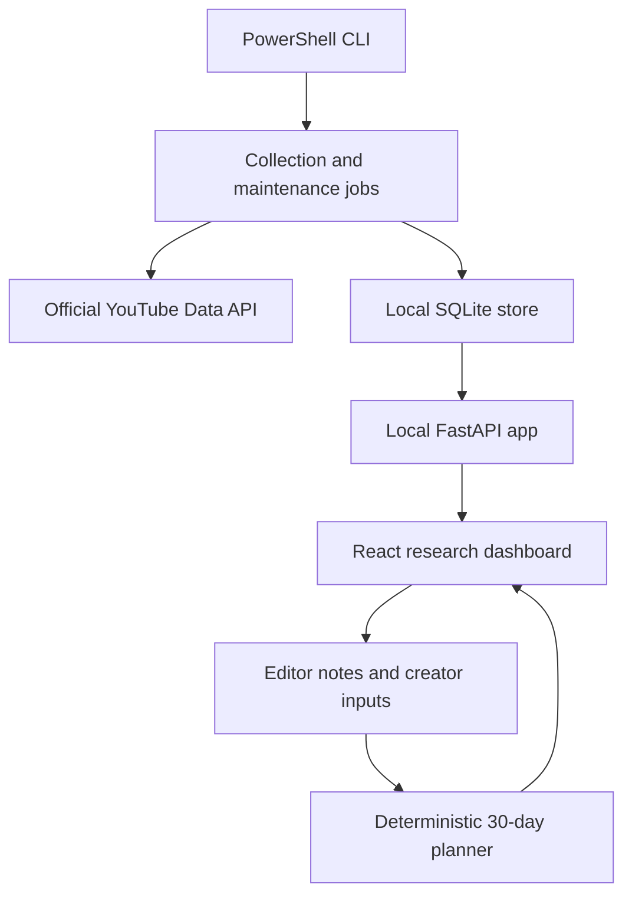

# System design

## Topology

## Stack

- **Backend:** a supported stable Python managed by `uv`, FastAPI, `httpx`, SQLite through the stdlib with versioned plain-SQL migrations, pytest, Ruff.
- **Frontend:** the active supported Node LTS, npm, React, TypeScript, Vite and CSS design tokens. Add at most one verified lightweight chart library, and only if justified. Use Playwright for critical browser flows if compatible.
- **Not used by default:** Docker, a separate warehouse, an ORM, Redis, distributed queues, an auth provider, scraping libraries, heavyweight ML stacks. Prefer the smallest maintained dependency footprint.

## Runtime

- One local app. In development, a Vite proxy keeps API requests same-origin. In the packaged local MVP, FastAPI serves the built UI.
- Servers bind to `127.0.0.1` only, never to the LAN.
- YouTube secrets live only in process env or a gitignored private local config, read by the backend and CLI. Never in `VITE_*`.
- A single documented data-directory override chooses the data location. Fixture and live databases use separate paths.
- Ingestion runs only through an explicit CLI, never from browser request handlers.
- SQLite settings: WAL, foreign keys on, a bounded busy timeout, bounded batch transactions, predictable crash recovery.
- No paid infrastructure for the local phases.
- Persistence sits behind repository interfaces so Phase 14 can add a hosted (Postgres) adapter without replacing local SQLite.
- **OneDrive caveat:** this repo currently sits under a OneDrive-synced folder with spaces in its path. Sync can interfere with SQLite WAL files, so Phase 01 should default the live data directory, or document an override, to a non-synced local path. All scripts must handle paths with spaces.

## Code boundaries

| Path | Responsibility |
|---|---|
| `backend/gta_lab/` | config, data access, YouTube adapter, collection, policy, research, planning, API |
| `frontend/` | React UI |
| `migrations/` | versioned SQL |
| `tests/` | backend and integration tests |
| `scripts/` | PowerShell wrappers (bootstrap/run/check; exit nonzero on failure) |
| `docs/` | specs and phase files |
| `local-data/` | runtime data, gitignored |

External resource data, sample-selection records, editor notes, own-channel notes and synthetic data stay logically separate. Never mirror raw YouTube records into logs, test fixtures, persistent exports, public APIs, cloud model prompts or Git.

## Internal routes

- UI: `/research`, `/evidence`, `/comparisons`, `/planner`, `/review`, `/data-health`, with shared navigation and error and empty states.
- Private localhost API: `/api/status`, `/api/evidence`, `/api/evidence/{id}`, `/api/research`, `/api/plan`, `/api/review`. These exist only to render the local app and manage first-party notes. No open proxy, no API-key exposure, no raw source dump.

## Data lifecycle (summary; rules in `docs/YOUTUBE_POLICY.md` and `docs/DATA_CONTRACT.md`)

collect (CLI) → hydrate → screen/eligibility → current stats stored with `fetched_at_utc` and a refresh/delete deadline → refresh before expiry → purge expired API-derived data → keep only independently authored notes.

## Run commands

Run from the repo root in Windows PowerShell 5.1+. `-ExecutionPolicy Bypass` applies to that one process only and changes no system setting. Every script exits nonzero on failure.

| Task | Command |
|---|---|
| Safe install (exactly as locked) | `powershell -ExecutionPolicy Bypass -File scripts\bootstrap.ps1` (`uv sync --locked` + `npm ci`) |
| Locked rebuild from scratch | `powershell -ExecutionPolicy Bypass -File scripts\bootstrap.ps1 -Clean` (removes repo-local `.venv`, `frontend\node_modules` and `frontend\dist` only) |
| Dev run (proxy) | `powershell -ExecutionPolicy Bypass -File scripts\dev.ps1` → open `http://127.0.0.1:5173/`. FastAPI with `--reload` runs on `127.0.0.1:8765`, and Vite proxies `/api` to it so the browser sees one origin |
| Packaged same-origin run | `powershell -ExecutionPolicy Bypass -File scripts\run.ps1 -Build` → open `http://127.0.0.1:8765/`. FastAPI serves `frontend\dist` and `/api` together |
| Full check | `powershell -ExecutionPolicy Bypass -File scripts\check.ps1` (add `-SkipAudit` offline: the audits then show as **not run**) |
| Effective settings (no secrets) | `uv run --locked python -m gta_lab config` |

Options: `run.ps1 -Mode demo|live -Port N -DataDir 'D:\path with spaces'`; `dev.ps1 -Mode -DataDir`.

### Settings (typed, `backend/gta_lab/config.py`)

| Variable | Default | Notes |
|---|---|---|
| `GTA_LAB_MODE` | `demo` | Explicit mode. `demo` = fixtures only, no network. `live` = real API data (collection arrives in later phases) |
| `GTA_LAB_DATA_DIR` | `%LOCALAPPDATA%\EngineerTestsGTA\data` | The single data-dir override. It is local and not synced. Demo DB in `demo\`, live DB in `live\`. `/api/status` warns if it is under OneDrive |
| `GTA_LAB_HOST` / `GTA_LAB_PORT` | `127.0.0.1` / `8765` | Non-loopback hosts are rejected at startup |
| `GTA_LAB_ENV_FILE` | `%LOCALAPPDATA%\EngineerTestsGTA\private.env` | Private config file, outside the repo and OneDrive. The repo `.env` is **not** read |
| `GTA_LAB_FRONTEND_DIST` | `frontend\dist` | Built UI location |
| `YOUTUBE_API_KEY` | unset | Process env or private env file only. Status shows only `configured` / `not configured` |

### Pinned runtimes and lockfiles (verified 2026-11-17)

- **Python 3.12** (`.python-version`; `requires-python >=3.12,<3.13`). The uv-managed 3.12.13 is used, never the PATH `python`.
- **Node ≥ 24** (`engines`). The local v24.13.1 is Maintenance LTS until 2028-04-30, per the nodejs/Release schedule. v26 became Active LTS on 2026-10-28; moving to it is a deliberate later upgrade.
- **Release-age cutoff:** dependencies resolved only from releases published before **2026-11-10** (`[tool.uv] exclude-newer` and `npm install --before=2026-11-10`). This skipped a few releases under a week old (for example fastapi 0.163.x and vite 8.3.8).
- Direct backend: fastapi 0.162.2, uvicorn 0.54.0, pydantic-settings 2.16.2. Dev: pytest 9.2.0, httpx 0.28.1, ruff 0.17.4, pip-audit 2.10.1. 51 packages in `uv.lock`.
- Direct frontend (exact pins): react / react-dom 19.3.1. Dev: vite 8.3.7, @vitejs/plugin-react 6.3.0, typescript 7.0.2, vitest 5.1.0, @types/react / @types/react-dom 19.3.0, @types/node 24.x. 90 resolved entries in `package-lock.json`. No package in the tree declares `preinstall`/`install`/`postinstall` scripts (checked with `npm query`).

**To upgrade a dependency safely:** move the cutoff date deliberately, then run `uv lock --upgrade-package <name>` or `npm install --save-exact --before=<date> <name>@<version>`, review the lockfile diff, and run `scripts\check.ps1`. Never run `npm audit fix --force`.

### Secret controls in the build

- `frontend/env-guard.ts` makes `vite build`/`vite dev` refuse to start if any `VITE_*` name looks secret (KEY, SECRET, TOKEN and similar). Only names are printed.
- `frontend/scripts/scan-bundle.mjs` scans `dist` for key patterns and for the exact value of any server secret env var present. `check.ps1` builds with a synthetic sentinel in `YOUTUBE_API_KEY` and then scans.
- `/api/status` uses a typed response model with no secret field. pytest and the real-process check both assert that the sentinel never appears.

## Toolchain (checked 2026-11-17, Phase 00; nothing installed)

| Tool | Found | Notes / recommended supported installer if missing |
|---|---|---|
| Git | 2.56.0.windows.4 | Present. If missing: `winget install --id Git.Git -e` |
| Windows PowerShell | 5.1.26100 | Present and sufficient for scripts. Scripts must run on 5.1 |
| PowerShell 7 (`pwsh`) | **missing** | Optional, not required. If wanted: `winget install --id Microsoft.PowerShell -e` |
| Python | 3.12.10 (Store `python`), 3.14.5 (`py`), uv-managed 3.12.13 | Several interpreters present. Phase 01 must pin one supported version via `uv` (`.python-version` / `requires-python`) and not rely on PATH `python`. If missing: `uv python install` or the python.org installer |
| uv | 0.12.0 | Present. If missing: `winget install --id astral-sh.uv -e` or Astral's official installer |
| Node.js | v24.13.1 (LTS "Krypton") | Present. Phase 01 verifies it is still a supported LTS. If missing: `winget install --id OpenJS.NodeJS.LTS -e` |
| npm | 11.10.0 | Bundled with Node |
| winget | 1.29.380 | Present; the preferred installer channel |

## References (verify at implementation time)

- Vercel: [FastAPI](https://vercel.com/docs/frameworks/backend/fastapi), [FastAPI/static assets guide](https://vercel.com/kb/guide/ship-a-fastapi-app-on-vercel), [SQLite limitation](https://vercel.com/kb/guide/is-sqlite-supported-in-vercel), [managed Postgres](https://vercel.com/docs/postgres), [environment variables](https://vercel.com/docs/environment-variables), [deployment protection](https://vercel.com/docs/deployment-protection), [Hobby restrictions](https://vercel.com/docs/plans/hobby)
- Coding agent: [Claude Code first day](https://support.claude.com/en/articles/14552382-your-first-day-in-claude-code), [Claude Code FAQ](https://support.claude.com/en/articles/14554922-claude-code-user-faq)
